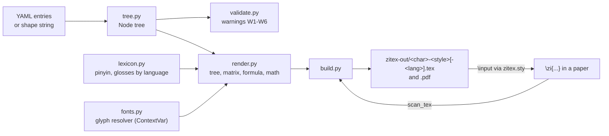

# CLAUDE.md

This file provides guidance to Claude Code (claude.ai/code) when working with code in this repository.

## What this is

**zitex** turns Chinese character decompositions (stored as YAML trees) into LaTeX for XeLaTeX: a decomposition tree, a nested-box "Zi-Matrix", a one-line formula, and a typeset equation (`日 + 寺 → 時`, pinyin above and gloss below each piece). It is part of the ZiNets project, and conceptbook-app (`/home/papagame/projects/digital-duck/conceptbook-app`) is meant to depend on it, so the Python API should stay stable. The plan is `docs/DEV/claude/readme.md` (milestones M0 to M4 done; M5 SQLite bridge and M6 zinets-app hook are deliberately postponed until the prototype is accepted). The grammar and position rules are `docs/DEV/claude/spec.md`. `docs/gemini/readme.md` is a buggy first draft, kept only as reference.

## Commands

Use the `zinets2` conda env (`/home/papagame/anaconda3/envs/zinets2`). The package is installed there in editable mode (`pip install -e . --no-deps`), which provides the `zitex` binary.

```bash
pytest -q                          # all tests (pytest finds the package via pythonpath = ["src"])
pytest tests/test_render.py::test_math_collapse_and_wrap   # one test
zitex check tests/data/chars.yaml  # validate decompositions (warnings never fail the run)
zitex build tests/data/chars.yaml --scan main.tex -x tests/data/lexicon.yaml -o zitex-out
zitex render 森 -f tests/data/chars.yaml -s math --collapse   # one snippet to stdout
zitex fonts tests/data/chars.yaml --fonts tests/data/fonts.yaml   # glyph coverage report
make -C examples/demo              # scan, build and typeset the demo with xelatex
```

Tests that compile LaTeX need `xelatex`, and the font tests need Droid Sans Fallback and AR PL UMing CN; they skip themselves otherwise. SVG glyphs need `inkscape`. There is no linter configured.

## Architecture

Python does all parsing and layout. LaTeX is only the last step, and `tex/zitex.sty` is deliberately thin (it `\input`s pre-built files).



- **Tree model (`tree.py`, `ops.py`).** A decomposition is a `Node` tree: leaf `c`, branch `op` + `parts`, and a branch may also carry `c` (a named composite such as 喿). `pos` is stored on every non-root node, per level, and is authored data, as in the SQLite DB. Positions are the 11 Zi-Matrix codes (`L R M U D Mi Mo LU LD RU RD`; Chinese names are accepted on input and converted on load), and a level's **pattern** is its children's positions joined by hyphens (`Node.pattern`, e.g. `L-M`). `M` is the center of gravity, and a Kangxi radical is peripheral (`radicals.py`), so 佛 is 亻 `L` + 弗 `M`. `ops.py` maps each operator to its *allowed patterns*: the 12 Unicode IDS operators plus ZiNets operators for flat patterns (`∴ ∵ ∷ ⁙`, and a general `<pattern>` form). The compact `shape` string is prefix form with fixed arity per operator and carries no positions: they are filled in from the operator's pattern, and for ⿰ and ⿱ from the radical rule. `喿(…)` names a composite, and `{name}` is a component with no code point. The notation and its mapping to IDS are specified in `docs/DEV/claude/zi-matrix.md`. `parse_shape`/`to_shape`  must round-trip, and tests check `shape` matches the stored tree.
- **Validation.** Codes W1 to W8 (unknown position, pattern not allowed for the operator, missing position, `shape` mismatch, wrong child count, empty children, overlapping regions, radical labelled M) are warnings by design, because the source DB is still being revised. Do not turn them into errors.
- **Readings.** An entry's roles (semantic, phonetic, force) live in named `readings`; `Entry.role` is the first (default) reading. Renderers get roles through `_roles(e)`, which uses a ContextVar set by `render_with(reading=...)`, so new renderers must use it and not `e.role` directly.
- **Renderers (`render.py`).** Every `render_*` returns a self-contained snippet with no document wrapper. Colours are defined inline with `\definecolor`, and fallback-font commands are prepended only when used. `render()` / `render_with()` is the entry point and sets the glyph resolver. All component text goes through `_g()` / `_tg()` so fallback fonts and images apply everywhere, so new renderers must use them. The `math` style uses only `\text`, `\overset`, `\underbrace`, `\xrightarrow` and `\left/\right`, so it works in MathJax as well as XeLaTeX.
- **Language-dependent styles and readings.** `math` and `formula` depend on `lang`, and their snippet names carry it (`藻-math-fr.tex`). A named reading adds `@reading` (`虹-math-en@dictionary.tex`). `snippet_name()` in `build.py` and `\zitex@name` in `tex/zitex.sty` must stay in sync, and `scan_tex()` must mirror what the sty does with `\zitexsetlang` / `\zitexsetreading` (it reads the file in order).
- **Fonts (`fonts.py`).** Resolution order is override (svg, font or alias), primary font, fallback fonts, then a boxed `U+XXXX` label reported as missing. Glyph coverage is read from font files with fontTools through fontconfig. A font that cannot be inspected is assumed to cover everything. Config keys written `{name}` are stored without braces.
- **Data files.** `tests/data/chars.yaml` is the 29-character test set (partly reviewed by the author), and its `decision:` fields record the author's choices, so do not "correct" them. `lexicon.yaml` holds pinyin and glosses (English and French, my drafts). `fallback.yaml` and `fonts.yaml` are synthetic data for the fallback tests.

## Conventions and gotchas

- Persistence is YAML, not JSON. The existing 5000-character SQLite DB is not final and is not touched by this code.
- Output is both `.tex` snippets (for `\input` into a paper) and compiled PDFs (`--emit tex|pdf|both`).
- XeLaTeX needs `\xeCJKDeclareCharClass{CJK}{"2234,"2235}` for the triangle operators; `document()` and `zitex.sty` already add it. The default font is Noto Serif CJK SC.
- Snippet file names use the character itself (UTF-8), which works on Linux and macOS but has not been tried on Windows.
- A YAML value that contains `: ` must be quoted, or the file will not load.
- Do not name anything `src` as an importable package: another `src` is installed in the conda base env. The package is `src/zitex/`, imported as `zitex`.
