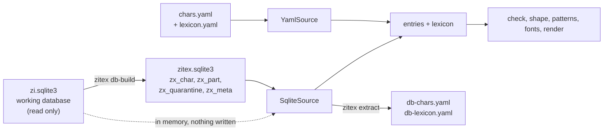

# SQLite integration: review, design and findings

Status: implemented on 2026-10-01. The database is the author's working database, `zi.sqlite3`, which is **a rough starting point: good for the prototype, and in need of review and revision for the correctness of its decompositions**. zitex converts whatever it contains, so the findings below describe that first iteration. The figures were read from a copy on that day, and change as the database is edited.

The original database file is **not part of this repository**: the master copy lives elsewhere, and `path/to/` in the commands stands for wherever it is. What the repository does carry is the small derived copy, `db/zitex.sqlite3` (about 1 MB), and the two CSV reports next to it, so a checkout can render, check and export the 6,000 characters without the original.

## 1. The safety rule

**zitex never writes to the working database.** Three things enforce it:

1. Every read opens the file read only (`mode=ro`).
2. zitex has its own four tables (`zx_*`), written to a **separate file** (`db/zitex.sqlite3` here), never into the source. The tables are a derived copy: delete the file and rebuild it any time.
3. `zitex db-build` checks that the source file is byte for byte what it was (SHA-256) when it finishes, and records the hash in `zx_meta`. The tests check the same for a synthetic database and for the real one.

Writing the `zx_*` tables into the working database itself is possible (`--in-place`), but it makes a dated backup copy first, and it is not the default.

## 2. What is in the database (review)

`zi.sqlite3` is 9.2 MB with 38 tables. Most are working copies (`w_*`) and archives. zitex reads four:

| Table | Rows | What zitex uses |
|---|---|---|
| `t_zi_part` | 6,205 | the decomposition: one row per character (all unique), one column per position (`zi_left_up` ... `zi_mid_in`) |
| `t_zi` | 11,274 | pinyin (with tone **numbers**, such as `shang4`) and an English definition (`desc_en`, CEDICT style) |
| `t_ele_zi` | 429 active | the elemental characters (元字): a one-word `meaning` and a `pinyin` with tone marks |
| `t_part` | 417 | radicals and parts: `meaning` and `pinyin` |

The other tables (`t_note`, `t_textbook_page`, `w_zi_shuowen_*`, and so on) are not read.

### The decompositions follow the paper

The first-level patterns of the 5,982 characters that convert cleanly track Figure 5 of the paper closely:

| Pattern | Here | Figure 5 |
|---|---|---|
| `L-M` | 3,004 | 3,033 |
| `U-D` | 705 | 727 |
| `U-M` | 664 | 688 |
| `L-R` | 547 | 534 |
| `M-R` | 286 | 301 |
| `U-M-D` | 112 | 139 |

(The small differences are the rows left out, see below.) The database has 60 distinct patterns. The 5-part pattern of 器 (`LU-RU-M-LD-RD`) is there too: 5 characters.

### What does not convert cleanly

| Count | Finding | What zitex does |
|---|---|---|
| 211 rows | a position cell holds more than one part (`L = 冖 一`, `U = 亠乂凵`) | **left out**, listed in `zx_quarantine` and the CSV report |
| 6 rows | only one part (incomplete) | left out |
| 5 rows | a part is the placeholder `?` | left out |
| 1 row | not active (`is_active` is blank) | left out |
| 21 rows | no parts at all (primitives) | kept as leaf entries, with a note |
| 469 components | not elemental and not decomposed (for example 卑 20 times, 夋 20, 兆 19, 亥 18, 肖 17) | they stay leaves in every tree. Listed in `*-undecomposed.csv`, most used first |
| 113 characters (218 counting nested levels) | the first-level pattern uses `Mi`: `M-Mi` 102, and 11 others (`U-M-Mi` 4, `U-M-D-Mi` 2, ...) | exported with a `review:` note, for the author's review of the `M-Mi` cases |
| 88 characters | a Kangxi radical is labelled `M` while the other part is not a radical (warning W8): the database and the radical rule disagree | warnings, to be reviewed |
| 14 characters | position regions overlap (W7), mostly `U-L-R`, the alias of `U-LD-RD` | warnings |
| 351 / 555 | exported characters without pinyin / without an English gloss | the lexicon has gaps there |

Two rules in the position data are worth knowing:

- **The column order is not the reading order.** The database orders the columns LU, L, LD, U, M, D, RU, R, RD, so `哭` comes out as `D, LU, RU`. zitex puts every level in the canonical reading order (`LU-RU-D`) before it works out the operator.
- **`U`, `D`, `L`, `R` can mean the middle cell of an edge.** `LU-U-RU-D` is three parts across the top, and `U-L-M-D` has a part left of `M`. The W7 check treats them that way.

## 3. The design: two adapters that give the same thing



Both adapters return **entries** (decomposition trees) and a **lexicon** (pinyin and glosses).

- **`YamlSource`** is the prototype path, unchanged: `chars.yaml` plus lexicon files.
- **`SqliteSource`** reads the `zx_*` tables, or the raw working tables (converted in memory, nothing written). For each character it builds the **same dictionary a `chars.yaml` entry loads from**, and calls the same `entry_from_dict`. After that there is one code path: validation, rendering and export are shared.
- **YAML is the intermediate form.** `zitex extract` writes the database (or just the characters you name) as `db-chars.yaml` and `db-lexicon.yaml` in the same compact style as the hand-written files. The export round-trips exactly (5,982 entries compared field by field in the tests), so the YAML can be reviewed, diffed and fed to `render` like any other.

### The `zx_*` tables

| Table | Holds |
|---|---|
| `zx_meta` | source file, size, SHA-256, build time, zitex version, counts |
| `zx_char` | `zi`, `pinyin` (tone marks), `gloss_en`, `meaning`, `is_elemental`, `is_root`, `has_parts` |
| `zx_part` | `zi`, `ord`, `pos`, `part`: one row per component, in reading order |
| `zx_quarantine` | `zi`, `reason`, `cells`: rows that could not be converted |

### How a character becomes a tree

1. The parts of a character are taken in reading order, and the pattern (such as `L-M`) selects the operator. A pattern no operator allows (`LU-LD-R`, anything with `Mi`) gets the general form `<pattern>`.
2. A part that has its own row, and is not elemental, is expanded into a **named branch**, down to the depth set by `--depth` (default 12, a guard against cycles). Elemental characters (`t_ele_zi`) stop the expansion, since they are irreducible by definition.
3. A part with no row stays a leaf.
4. The shape string is generated from the tree, and the entry goes through the normal loader.

### Pinyin and glosses

- Pinyin is converted from tone numbers to tone marks (`xie4` becomes `xiè`, `nu:3` becomes `nǚ`). With several readings (`qiao2 / shao4`, `fo2; fu2`) the **first** is used.
- A gloss comes first from the curated one-word meanings of `t_ele_zi` and `t_part`, and otherwise from the dictionary definition `desc_en`. CEDICT notes are cleaned: `(bound form)` is dropped, and cross-references like `CL:臺|台[tai2]` are skipped. The first sense is the gloss, and up to three senses make the entry's `meaning`.
- A lexicon file given with `-x` (or a `lexicon.yaml` in the current folder) **replaces** what the database says for the characters it names.

## 4. Commands

```bash
zitex db-build path/to/zi.sqlite3 -o db/zitex.sqlite3 --report db/zitex-quarantine.csv   # once, and after the database changes
zitex patterns db/zitex.sqlite3                                  # the table behind Figure 5
zitex check db/zitex.sqlite3                                     # validate every converted character
zitex render db/zitex.sqlite3 -c 器,藻 -o figs/                  # render straight from the database
zitex extract db/zitex.sqlite3 -c 器,藻                          # or extract them as YAML for review
```

All of them also accept the raw `zi.sqlite3` (converted in memory, nothing written). `db-build` is what makes the clean copy persistent, and keeps a record of what was left out.

## 5. Open points

1. **The 223 left-out rows.** The 211 multi-part cells are the largest group. They need a decision for each: split into a nested level, or fix in the database. They are in `zitex-quarantine.csv`, written by `--report`.
2. **The 469 undecomposed components.** Either add rows for them, or add them to the elemental set. They are in `zitex-quarantine-undecomposed.csv`.
3. **The `M-Mi` cases** (102 at the first level, 113 with the other `Mi` patterns), already on the author's list.
4. **The 88 radical-labelled-`M` cases.** Each is either a data error or a place where the rule has an exception.
5. **Roles** (semantic, phonetic) are not in the tables read here. `t_ele_zi.phono` and the Shuowen tables might hold them, and the `readings` feature could carry them.
6. **The derived files** (`db/zitex.sqlite3` and the CSV reports) are committed on purpose, so the data is available without the original. They are generated: rebuild them with `zitex db-build` after the database changes, and commit the new versions. The tests use a small synthetic database, not these files.
7. **Licence of the glosses: handled.** The English glosses and meanings (and the pinyin of non-elemental characters) come from CEDICT-style definitions in `t_zi`, so they carry **CC BY-SA 4.0** terms. The data is attributed to CC-CEDICT in `db/NOTICE.md` and the README, in `zx_meta` (key `attribution`), and in the header of every exported YAML file, with the changes made listed. The attribution rests on the structure of the source tables (`w_cedict_*`, `CL:` and `[pinyin]` notes), not on an entry-by-entry check. Whether the source file is CC-CEDICT 4.0 or an older version should be confirmed from its header.
