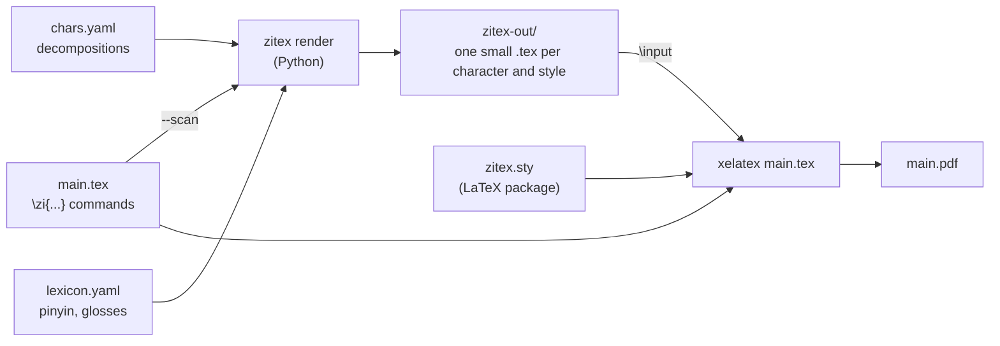

# How LaTeX is extended to make zitex work

zitex adds Chinese character decompositions to LaTeX without adding a large LaTeX program. The short version: **Python does the thinking, LaTeX does the typesetting.** Python reads the decompositions and works out the layout, and writes small LaTeX files. A thin LaTeX package, `zitex.sty`, pulls those files into a document. This page explains each piece and why it is built this way.

## 1. The two halves



| Half | Does | Written in |
|---|---|---|
| `zitex render` | parse a shape, check positions, pick a layout, compute coordinates, look up pinyin and glosses, resolve fonts, write LaTeX | Python (`src/zitex/`) |
| `zitex.sty` | load the packages the snippets need, define the `\zi` commands, find and `\input` the right snippet | LaTeX (one file of about 60 lines) |

Your document never contains a decomposition. It contains `\zimath{時}`, and LaTeX finds the snippet that Python wrote for 時.

## 2. Why not do it all in LaTeX macros?

The first sketch of zitex (in `docs/DEV/gemini/`) was one big LaTeX package with an 11-argument macro for the Zi-Matrix. It did not scale, for three reasons:

- **Parsing is awkward in TeX.** A shape string like `⿱艹⿰氵喿(⿱品(∴口口口)木)` is a nested prefix expression with fixed arities, named groups and several kinds of operator. In Python it is a 40-line recursive function. In TeX it would be a fragile pile of `\expandafter`.
- **Layout needs arithmetic and tables.** The matrix is laid out recursively, sharing a box between parts, and the flat patterns (`LU-RU-M-LD-RD` and so on) need a small solver. TeX can do arithmetic, but not comfortably.
- **Data does not belong in a document.** The decompositions, roles, glosses and fonts live in YAML files that people review. Python reads them directly, tests them, and checks them (`zitex check`). LaTeX never sees them.

So the LaTeX side was kept dumb on purpose: it knows only file names.

## 3. What `zitex.sty` does

`src/zitex/zitex.sty` is the whole LaTeX extension. It does five things.

### 3.1 Loads what the snippets need

```latex
\RequirePackage{fontspec}   % fonts by name
\RequirePackage{xeCJK}      % Chinese typesetting, per-character font switching
\RequirePackage{amsmath}    % \underbrace, \overset, \xrightarrow for the equations
\RequirePackage{graphicx}   % \includegraphics for glyphs drawn as images
\RequirePackage{tikz}       % the matrix and tree drawings
\RequirePackage{xkeyval}    % key=value options for \zi[...]
```

This is why zitex needs **XeLaTeX**: `xeCJK` and `fontspec` work with XeTeX, and they use system fonts directly, which is how Noto Serif CJK is selected. (LuaLaTeX would need different CJK packages; zitex has not been tried with it.)

### 3.2 Sets the Chinese font and one detail of XeLaTeX

```latex
\setCJKmainfont{Noto Serif CJK SC}
\xeCJKDeclareCharClass{CJK}{"2234,"2235,"2237}
```

The second line matters. The ZiNets operators `∴` `∵` `∷` are math symbols in Unicode (U+2234, U+2235, U+2237), and `xeCJK` does not treat them as Chinese characters, so XeLaTeX tried to print them in the Latin font, which lacks them, and showed nothing. Declaring them part of the `CJK` class makes `xeCJK` use the CJK font for them. You can change the font after `\usepackage{zitex}` with `\setCJKmainfont`.

### 3.3 Defines the commands

```latex
\zi[style=tree|matrix|formula|math, lang=fr, reading=author]{藻}
\zitree{藻}   \zimatrix{藻}   \ziformula{藻}   \zimath{藻}
\zitexsetlang{fr}   \zitexsetreading{author}   \zitexsetpath{zitex-out}
```

`\zi` opens a group, sets defaults (style `tree`, the current language and reading), applies your `[options]` with `\setkeys`, and builds a file name. The shorthands `\zitree` and the rest are one-line wrappers that fix the style.

### 3.3.1 The file name is the contract

```latex
\ExplSyntaxOn
\newcommand\zitex@cp[1]{u\int_to_hex:n{`#1}}      % 藻 (U+85FB) becomes u85fb
\ExplSyntaxOff
\newcommand\zitex@name[1]{%
  \zitex@cp{#1}-\zitex@style
  \ifx\zitex@style\zitex@math -\zitex@lang\fi
  \ifx\zitex@style\zitex@formula -\zitex@lang\fi
  \ifx\zitex@reading\zitex@empty\else @\zitex@reading\fi}
```

`\zimath[lang=fr, reading=dictionary]{虹}` becomes `zitex-out/u8679-math-fr@dictionary.tex` (虹 is U+8679). The character is named by its code point in lower-case hex, so every file name is plain ASCII and safe on any file system or archive. Each build also writes `zitex-out/build_manifest.json`, which lists every snippet with its character, code point, style, language, reading and file name, and the fallback fonts, images and undrawable components it uses. Python writes the files under the same rule (`snippet_name()` in `src/zitex/build.py`), and **the two must stay in sync**. That is the only interface between the halves. The language is part of the name only for the styles that print glosses (`math`, `formula`), and `@reading` only when a reading was asked for.

### 3.4 Includes the snippet, or says it is missing

```latex
\IfFileExists{\zitex@file}%
  {\input{\zitex@file}}%
  {\PackageWarning{zitex}{Missing \zitex@file; run `zitex render`}%
   \textcolor{red}{\textbf{[#2?]}}}%
```

If the file exists, `\input` pastes it in. If not, LaTeX prints a warning and shows a red `[字?]` in the page, so the document still compiles and the gap is visible. A missing snippet should never stop a long build.

### 3.5 One small trap

The reading is stored in a macro, and "is it empty?" is tested with `\ifx`. `\ifx` also compares whether a macro is defined as `\long`, and `\newcommand` makes macros `\long`. So an empty macro made with `\newcommand` is **not** equal to an empty macro made with `\def`, and every file name got a stray `@`. The package therefore defines these macros with plain `\def` and compares against its own empty macro. The comment in `zitex.sty` records this.

## 4. What a snippet looks like

Python writes one self-contained file per character and style. Four examples for 時 (日 meaning on the left, 寺 sound on the right).

**`math`: the equation.** Plain LaTeX math, using only commands that MathJax and KaTeX also support, so the same string works on a web page:

```latex
\[ \underbrace{\overset{\text{rì}}{\text{日}}}_{\text{sun}} + \underbrace{\overset{\text{sì}}{\text{寺}}}_{\text{temple}} \xrightarrow{\text{sound: sì}} \underbrace{\overset{\text{shí}}{\text{時}}}_{\text{time}} \]
```

`\overset` puts the pinyin above, `\underbrace` puts the gloss below with a brace, and `\xrightarrow` carries the reason for the combination. Python decides what goes where. LaTeX only typesets it.

**`formula`: one line.**

```latex
日 + 寺 $\rightarrow$ \textbf{時} {\small(shí, time)}
```

**`matrix`: nested boxes.** TikZ with coordinates that Python computed:

```latex
\begin{tikzpicture}[every node/.style={inner sep=0pt, outer sep=0pt, align=center}]
  \draw[draw=zi-border!70, fill=zi-default, thick] (0.000,0.000) rectangle (4.400,4.400);
  \draw[draw=zi-border!70, fill=zi-semantic, ] (0.030,0.030) rectangle (2.170,4.370);
  \node[] at (1.100,2.200) {\fontsize{37.8pt}{37.8pt}\selectfont 日};
  \draw[draw=zi-border!70, fill=zi-phonetic, ] (2.230,0.030) rectangle (4.370,4.370);
  \node[] at (3.300,2.200) {\fontsize{37.8pt}{37.8pt}\selectfont 寺};
\end{tikzpicture}
```

The rectangles are the left and right halves, the font size is chosen to fit each box, and the fill colour comes from the role of each part (semantic, phonetic, ...).

**`tree`: a decomposition tree.** Also TikZ: one node per component at computed coordinates, edges drawn from a parent to its children, and a small position label (`L`, `M`) on each edge. The tree is laid out by Python, not by a TikZ tree library, so a three-part or five-part level costs nothing extra.

### Two details that make snippets self-contained

- **Colours are defined inside every snippet.** Each starts with `\definecolor{zi-semantic}{RGB}{214,234,248}` and the other colours it uses, so a snippet works when `\input` into any document, not only one that loaded `zitex.sty`.
- **A snippet that needs a special font carries its own helpers** (next section), declared with `\providecommand` so they never clash with the package.

## 5. Fonts and glyphs that are not in the font

A snippet may contain a component that Noto Serif CJK does not have: a rare character, or an oracle-bone component that has no Unicode code point at all. Python checks each component against the font files (with fontTools) and writes one of four forms. The extra commands are added to the top of the snippet, and only when used:

```latex
\providecommand\zifont[3]{{\expandafter\ifx\csname zifam@#1\endcsname\relax
  \setCJKfamilyfont{zifam@#1}{#2}\expandafter\gdef\csname zifam@#1\endcsname{}\fi\CJKfamily{zifam@#1}#3}}
\providecommand\zisvg[1]{\raisebox{-0.12em}{\includegraphics[height=0.9em]{\zitexpath/glyphs/#1}}}
\providecommand\zimissing[1]{\fbox{\scriptsize #1}}
```

| Situation | What Python writes |
|---|---|
| the font has the glyph | the character itself |
| a fallback font has it | `\zifont{1}{AR PL UMing CN}{𠂉}` : a group that switches the CJK font for that one character. `xeCJK` defines the font family on first use |
| it is drawn as an image | `\zisvg{demo.pdf}` : the SVG was converted to PDF with Inkscape and is included at text height |
| nothing can draw it | `\zimissing{U+20009}` : a boxed label, and a warning in the build output |

This is how an oracle-bone component with no code point can be set inside an equation or a matrix like any other part. It is just a name (`{name}`) in the shape string, and `fonts.yaml` says what to draw for it.

## 6. Two kinds of output

Python can also compile a figure by itself. For `--emit pdf`, it wraps the snippet in a tiny document and runs XeLaTeX:

```latex
\documentclass[border=6pt,varwidth]{standalone}
\usepackage{fontspec}
\usepackage{xeCJK}
\setCJKmainfont{Noto Serif CJK SC}
\xeCJKDeclareCharClass{CJK}{"2234,"2235,"2237}
\usepackage{amsmath}
\usepackage{graphicx}
\usepackage{tikz}
\begin{document}
  ... the snippet ...
\end{document}
```

This is the same package list as `zitex.sty`, so a snippet compiles the same way in both places. Use the `.pdf` when you want a figure for a slide or a web page. Use the `.tex` snippet when the figure should sit inside a paper and follow its fonts and page layout.

## 7. How the pieces find each other

1. **`zitex render --scan main.tex`** reads the paper as text, looks for `\zi`, `\zimath`, `\zitree`, `\zimatrix` and `\ziformula`, and notes the character, style, language and reading of each. It follows `\zitexsetlang{fr}` and `\zitexsetreading{author}` in order, the way the package does, so a default set mid-document applies to the calls after it. It then renders exactly those snippets into `zitex-out/`.
2. **`xelatex main.tex`** loads `zitex.sty`. LaTeX must be able to find that file, which is what `zitex install-sty` does (it copies the file into your personal TeX folder, usually `~/texmf/tex/latex/zitex/`). Without installing, `TEXINPUTS=<folder>:` points a single run at it.
3. At each `\zi...` command, the package builds the file name and `\input`s `zitex-out/<name>.tex`.

The `zitex-out/` folder is looked up relative to where `xelatex` runs, and can be changed with `\zitexsetpath{...}`.

## 8. The `readings` idea in one sentence

Which part of a character carries the meaning and which the sound is an interpretation, and a character can store several. The reading chosen (`reading=dictionary`) only changes how the snippet is coloured and what the arrow says; the structure never changes. It is passed to Python through the file name, so the LaTeX side needs no new logic beyond adding `@dictionary` to it.

## 9. Where to look in the code

| Piece | File |
|---|---|
| the LaTeX package | `src/zitex/zitex.sty` |
| snippet writers (tree, matrix, formula, math) and the PDF wrapper | `src/zitex/render.py` |
| file naming, `--scan`, writing and compiling | `src/zitex/build.py` |
| font coverage, fallbacks, SVG glyphs, the extra helper commands | `src/zitex/fonts.py` |
| the command line | `src/zitex/cli.py` |
| positions, operators and the parser | `src/zitex/ops.py`, `tree.py` |

A change to the file-name rule has to be made in two places: `snippet_name()` in `build.py`, and `\zitex@name` in `zitex.sty`. A test (`test_sty_end_to_end` in `tests/test_cli.py`) fails if they drift apart.
